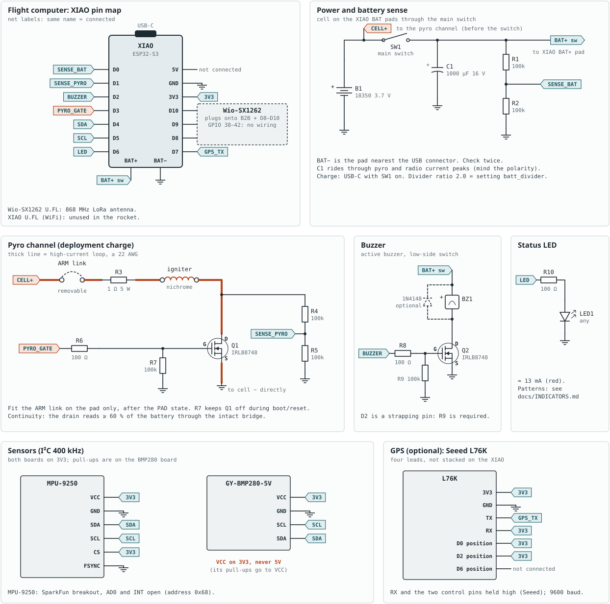
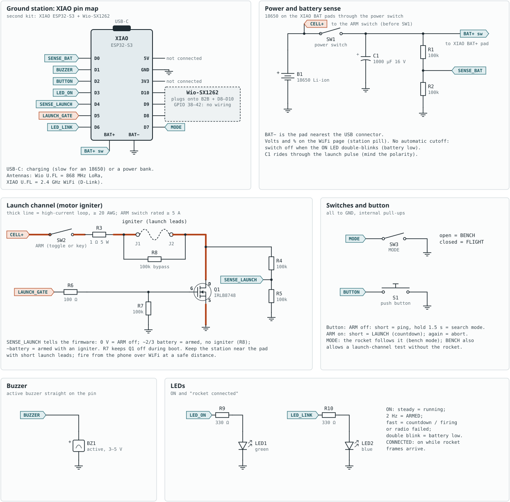

# rocket-fc

Open-source flight computer and ground station for model rockets, built on
the **Seeed XIAO ESP32-S3 + Wio-SX1262** (LoRa) kit.

The flight computer detects launch and apogee, fires the parachute ejection
charge, logs the flight to its own flash and sends live telemetry. A second
kit is the ground station: it receives the telemetry, serves the whole
control page over its own WiFi to a phone or laptop, and can be the launch
controller for the motor igniter.

> **Status:** version 0.1, bench-tested, not yet flown. Read
> [Safety](#safety) before building.

## Features

**Flight computer**
- Launch, burnout, apogee and landing detection (Kalman filter on barometer
  + accelerometer); single-shot ejection with lockout, confirmation and
  minimum altitude; optional deployment delay and backup timer.
- Layered pyro safety: hardware arm link, gate pull-down, software interlock
  until launch is detected, one shot per flight even across resets.
- Resumes a flight after an in-flight processor reset.
- Flight log in the XIAO's flash (4.8 MB, sessions kept after power-off) and
  PSRAM; no SD card needed.
- LoRa telemetry with CRC, duty-cycle limiter (EU 869 MHz by default) and
  event priority; attitude estimate; optional L76K GPS for recovery.
- LED and buzzer codes for every state, self-test faults and the landed
  altitude.

**Ground station**
- WiFi access point serving the UI: live gauges, attitude, plots, events,
  GPS recovery bearing, battery, both kits' settings and consoles, onboard
  log download. No app, no internet, no laptop needed.
- Launch controller: ARM switch, igniter continuity, countdown, abort.
- BENCH / FLIGHT mode switch the rocket follows; ping and signal-search mode;
  manual ejection by radio (optional, off by default).
- Every panel part (switches, button, buzzer, LEDs, battery) is optional.

**Software**
- Every tunable value is a setting: stored in flash, edited from the UI,
  identified by a CRC that is logged with the firmware commit.
- Decision logic is hardware-independent and unit-tested on the PC (17 test
  suites, including complete simulated flights).

## Hardware

| Kit | Parts |
|---|---|
| Flight computer | XIAO ESP32-S3 + Wio-SX1262, MPU-9250 IMU, BMP280 barometer, IRLB8748 pyro MOSFET, buzzer, LED, 18350 Li-ion cell, optional L76K GPS |
| Ground station | XIAO ESP32-S3 + Wio-SX1262, 18650 Li-ion cell (or a power bank), optional ARM / MODE switches, push button, launch MOSFET, buzzer, two LEDs |

| Flight computer | Ground station |
|---|---|
| [](docs/schematics/flight.svg) | [](docs/schematics/ground.svg) |

Full parts list, assembly and first-time setup:
**[docs/BUILD.md](docs/BUILD.md)**.

## Quick start

1. Build the two kits ([docs/BUILD.md](docs/BUILD.md)).
2. Install [VS Code](https://code.visualstudio.com/) with the **PlatformIO
   IDE** extension, clone this repository and open it.
3. Flash each kit over USB-C:
   ```
   pio run -e flight -t upload     # flight computer
   pio run -e ground -t upload     # ground station
   ```
4. Join the station's WiFi `rocketfc-XXXX` (password: `wifi` on its USB
   console the first time) and open **http://192.168.4.1**.
5. Set your own pairing key `rf_key`, press **Set upright**, and work
   through [docs/TESTING.md](docs/TESTING.md).

| PlatformIO env | Builds |
|---|---|
| `flight` | Flight computer firmware. One firmware for bench and flight: the test commands (simulated flight, test fire) need **bench mode**, which follows the ground station's MODE and ends at launch. |
| `ground` | Ground station firmware, with the UI embedded. |
| `native` | Unit tests on your computer: `pio test -e native` (needs a C++ compiler). |

## Safety

This project drives pyrotechnic charges and motor igniters.

- Run the whole bench procedure in [docs/TESTING.md](docs/TESTING.md) with a
  dummy load and bare nichrome **before fitting any charge**.
- Fit arm links and connect igniters last, at the pad, from the side.
- Read [docs/FLIGHT_LOGIC.md](docs/FLIGHT_LOGIC.md) to know exactly when the
  charge can fire.
- Set your own `rf_key` (the default is public) and keep the station's WiFi
  password private: anyone on that WiFi has the launch and ejection controls.
- Fly under your club's and your country's rules, including the radio rules
  for the band you use.

The software is provided as is, without warranty (see [LICENSE](LICENSE)).

## Documentation

| Document | Contents |
|---|---|
| [BUILD.md](docs/BUILD.md) | Parts, wiring, flashing, first-time setup, troubleshooting |
| [HARDWARE.md](docs/HARDWARE.md) | Pin maps, power, pyro and launch circuits, ground station panel, WiFi |
| [TESTING.md](docs/TESTING.md) | Unit tests, bench tests, pre-flight checklist |
| [FLIGHT_LOGIC.md](docs/FLIGHT_LOGIC.md) | States, deployment rules, interlocks, failure handling |
| [SETTINGS.md](docs/SETTINGS.md) | Every setting, how to change them, radio rules, bench mode |
| [INDICATORS.md](docs/INDICATORS.md) | LED patterns and buzzer codes |
| [TELEMETRY.md](docs/TELEMETRY.md) | Radio protocol, frame formats, CSV columns, logs |
| [ARCHITECTURE.md](docs/ARCHITECTURE.md) | Code structure, data flow, how to extend |

## Repository layout

```
include/        pin map (board_pins.h) and fixed constants
lib/fc_core/    hardware-independent logic, unit-tested on the PC
                (state machine, estimator, telemetry, settings, flash log, GPS,
                 launch control, remote-command codes, ...)
lib/fc_hal/     drivers: MPU-9250, BMP280, SX1262, GPS UART, flash, pyro, ADC, system
src/flight/     flight computer firmware (wiring of core + drivers)
src/ground/     ground station firmware and its WiFi server
test/           unit tests (pio test -e native)
tools/          ground_station.html (the UI), ground_station.py (USB recorder),
                schematics.py (wiring drawings), build scripts
docs/           documentation and schematics
```

## Traceability

Every build is stamped with its git commit (`-dirty` if there were
uncommitted changes), printed at boot and logged as the first telemetry
event. The settings in use are identified by a CRC-32 (boot banner,
`status`, CONFIG event). Fly clean builds and keep the exported settings
file: a log then identifies exactly which code and configuration flew.

## Contributing

Bug reports, flight reports, hardware variants and code are welcome. See
[CONTRIBUTING.md](CONTRIBUTING.md) and the
[code of conduct](CODE_OF_CONDUCT.md). Changes are listed in
[CHANGELOG.md](CHANGELOG.md).

## License

[MIT](LICENSE).
