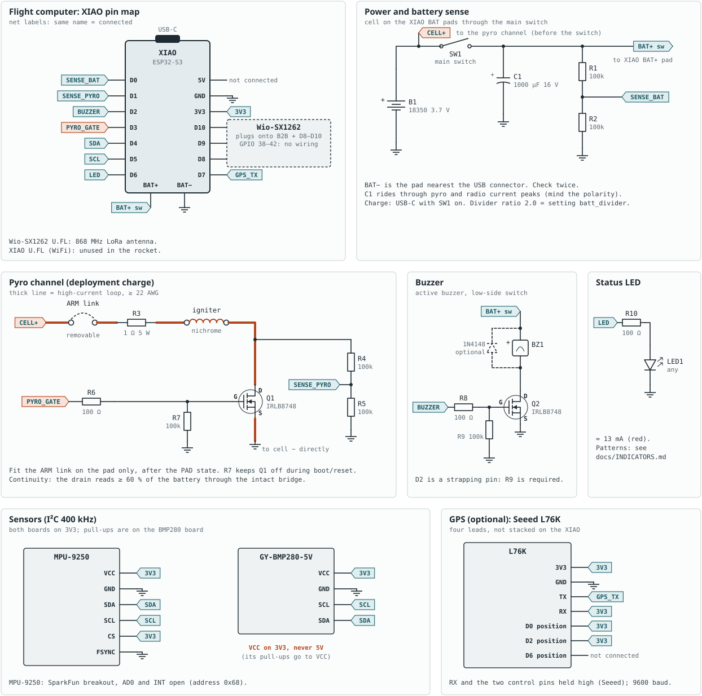
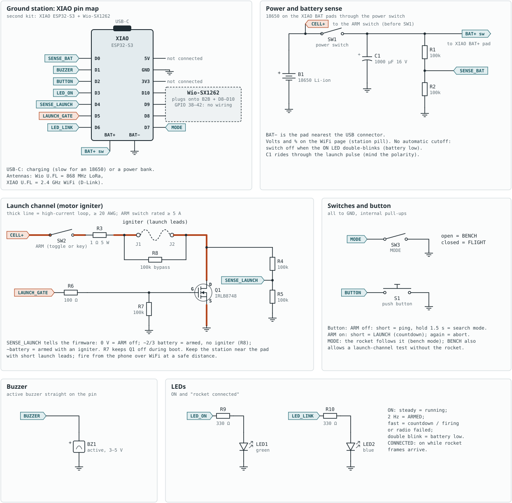

# Build guide

From parts to a first bench test. Allow an afternoon for each kit. Details
behind each step are in [HARDWARE.md](HARDWARE.md); the full test procedure
is in [TESTING.md](TESTING.md).

1. [Parts](#1-parts)
2. [Wiring](#2-wiring)
3. [Software and flashing](#3-software-and-flashing)
4. [First-time setup](#4-first-time-setup)
5. [First checks](#5-first-checks)
6. [Troubleshooting](#6-troubleshooting)

## 1. Parts

### Flight computer

| Part | Qty | Notes |
|---|---|---|
| Seeed XIAO ESP32-S3 + Wio-SX1262 kit | 1 | Processor and LoRa radio, with the 868/915 MHz antenna |
| MPU-9250 breakout (SparkFun or similar, no regulator) | 1 | MPU-9255/6500 also work (no magnetometer on the 6500) |
| GY-BMP280-5V breakout (4 pins) | 1 | BME280 also works; powered from 3V3 |
| 18350 Li-ion cell (≈ 700 mAh) | 1 | Soldered tabs or a tight holder |
| IRLB8748PBF logic-level MOSFET | 1 | Pyro driver |
| Resistor 1 Ω 5 W | 1 | Pyro current limit |
| Resistor 100 Ω | 2 | Gate, LED |
| Resistor 100 kΩ | 5 | Gate pull-down, battery and continuity dividers |
| Electrolytic capacitor 1000 µF 16 V | 1 | Across the battery |
| Active buzzer, 3–5 V | 1 | Straight on the pin |
| LED, 3 or 5 mm | 1 | Status |
| Slide switch (≥ 0.5 A) | 1 | Main power |
| 2-pin screw terminals | 2 | Arm link, igniter |
| Seeed L76K GNSS module | 0–1 | **Optional** GPS for recovery |
| 100 nF capacitors | 0–2 | Optional, on D0 / D1 |
| Perfboard, ≥ 22 AWG wire for the pyro loop, ferrules for nichrome | | |

### Ground station

| Part | Qty | Notes |
|---|---|---|
| Seeed XIAO ESP32-S3 + Wio-SX1262 kit | 1 | Use the 2.4 GHz antenna from the XIAO box for WiFi |
| 18650 Li-ion cell + holder | 1 | Or run it from a USB power bank |
| Slide switch (SW1) | 1 | Power |
| Toggle or key switch rated ≥ 5 A (SW2) | 1 | ARM: carries the igniter current |
| Toggle switch (SW3) | 1 | MODE: open = BENCH, closed = FLIGHT |
| Push button (S1) | 1 | Ping / search / launch |
| IRLB8748PBF logic-level MOSFET | 1 | Launch driver |
| Resistor 1 Ω 5 W | 1 | Launch current limit |
| Resistor 100 Ω | 1 | Gate |
| Resistor 100 kΩ | 6 | Gate pull-down, two dividers, ARM bypass (R8) |
| Resistor 330 Ω | 2 | LEDs |
| LED green + LED blue | 2 | ON, CONNECTED |
| Active buzzer, 3–5 V | 1 | |
| Electrolytic capacitor 1000 µF 16 V | 1 | |
| Launch lead terminals (J1/J2) and launch leads | | ≥ 20 AWG |

**Everything except the XIAO and the radio is optional on the ground
station.** Without switches, button, buzzer or LEDs it still works, with
every control on the WiFi page (table in [HARDWARE.md](HARDWARE.md#ground-station-second-kit)).
A minimal station is the bare kit on a power bank.

### Tools

Soldering iron, multimeter (needed for calibration and continuity checks),
USB-C data cable (some cables only charge), 1 cm pieces of 32 AWG nichrome
for bench tests.

## 2. Wiring

The drawings are generated from [tools/schematics.py](../tools/schematics.py)
(`python tools/schematics.py docs/schematics`). Net labels with the same name
are connected. Pin numbers are defined once in
[include/board_pins.h](../include/board_pins.h).

### Flight computer



Assembly order (test as you go):

1. **Radio first.** Plug the Wio-SX1262 onto the XIAO and fit its antenna.
   Never power the kit without the LoRa antenna.
2. **Battery wires.** If the radio board covers the BAT pads, unplug it,
   solder thin wires to the pads, route them out, plug it back in.
   **BAT− is the pad nearest the USB connector.** Reversing the cell
   destroys the board.
3. **Power:** cell → main switch → BAT+; 1000 µF across BAT+/GND (mind
   polarity); battery divider (2 × 100k) to D0.
4. **Sensors:** MPU-9250 and BMP280 on 3V3, SDA = D4, SCL = D5. BMP280 VCC on
   **3V3, never 5V**. MPU-9250: CS to 3V3, FSYNC to GND.
5. **Buzzer** on D2, **LED** with 100 Ω on D6.
6. **Pyro channel last:** from the cell + *before* the main switch → arm-link
   terminal → 1 Ω 5 W → igniter terminal → MOSFET drain; source straight to
   cell −. Gate: D3 → 100 Ω → gate, 100k gate to GND. Continuity divider
   (2 × 100k) from the drain to D1. Thick wire for the whole loop.
7. **GPS (optional):** L76K TX → D7; its 3V3, RX and the two control pins at
   its D0 / D2 positions to 3V3; GND to GND. Do not stack it on the XIAO.

Mount the IMU with one axis along the rocket's long axis (any of ±X, ±Y,
±Z; the direction is set in software later). Give the barometer a vented,
foam-covered bay.

### Ground station



1. Radio onto the XIAO, LoRa antenna on the Wio-SX1262, **WiFi antenna on
   the XIAO's own U.FL** (without it the WiFi range is about a metre).
2. 18650 → SW1 → BAT+, 1000 µF, battery divider to D0.
3. Panel: button S1 (D2), MODE switch SW3 (D7), both to GND. Buzzer on D1.
   ON LED (D3) and CONNECTED LED (D6) with 330 Ω.
4. Launch channel: cell + (before SW1) → ARM switch SW2 → 1 Ω 5 W → J1 …
   igniter … J2 → MOSFET drain; source → cell −. R8 (100k) across J1/J2.
   Gate D5 via 100 Ω, 100k pull-down. Divider (2 × 100k) from the drain to D4.

## 3. Software and flashing

1. Install [VS Code](https://code.visualstudio.com/) and the **PlatformIO IDE**
   extension (or `pip install platformio`).
2. Clone this repository and open the folder in VS Code. PlatformIO downloads
   the toolchain and libraries on the first build (pinned versions).
3. Connect the **flight computer** by USB-C, then in a PlatformIO terminal:

   ```
   pio run -e flight -t upload
   ```

4. Connect the **ground station** and run:

   ```
   pio run -e ground -t upload
   ```

   The WiFi page (`tools/ground_station.html`) is built into this firmware.

With both kits connected at once, choose the port:
`pio run -e ground -t upload --upload-port COM7` (Windows) or
`/dev/ttyACM1` (Linux). If the port is not found, see
[Troubleshooting](#6-troubleshooting).

Serial console of either kit: `pio device monitor` (115200 baud), then type
`help`.

## 4. First-time setup

### Join the ground station's WiFi

1. Switch the ground station on (or power it by USB).
2. The WiFi password is random, made at the first boot. Read it once over
   USB: `pio device monitor`, type `wifi`.
3. Join the network `rocketfc-XXXX` and open **http://192.168.4.1** (or
   http://rocketfc.local). If the phone warns that there is no internet,
   choose to stay connected.
4. Optional: set your own password in the UI (Radio link → WiFi) and reboot
   the station.

### Set your own pairing key (required)

`rf_key` authenticates the commands the station sends the rocket (bench mode,
console, test fire, ejection, WiFi). The default value is public, and both
kits print a warning while it is unchanged.

1. Switch both kits on, rocket in range. UI → **Settings** → **Read settings**.
2. Set `rf_key` to any 8-digit hex value of your own (e.g. `0x3F9A12C7`).
   The UI changes it on both kits.
3. **Save to flash**, then reboot the **rocket first**, then the station.

The same rule applies to every radio setting (`radio_*`): they must be equal
on both kits.

### Radio band

The default channel is 869.525 MHz, inside the European 869.4–869.65 MHz
band with a 10 % duty-cycle limit. Elsewhere (e.g. 915 MHz in the Americas)
set `radio_unlock` = 1 and `radio_freq_mhz` on both kits. You are responsible
for the radio rules where you operate ([SETTINGS.md](SETTINGS.md#radio-settings-both-kits)).

### Set upright (IMU mounting)

Stand the rocket (or the board, as mounted) nose up, keep it still, press
**Set upright** in the Attitude panel. The rocket finds the IMU axis that
points to the nose, saves it and asks to reboot. Afterwards the tilt reads
about 0° when upright. Repeat whenever you remount the IMU.

### Calibrate the voltage dividers

Measure each cell with a multimeter (USB unplugged) and compare:

| Kit | UI reading | Setting (divider ratio, default 2.0) |
|---|---|---|
| Flight | Battery → Rocket voltage | `batt_divider` |
| Station | Radio link → Ground station → Battery | `gs_batt_divider` |

New ratio = old ratio × (multimeter ÷ reading). A 1 % resistor pair is
usually within 0.03 V without calibration. `pyro_divider` and
`gs_launch_divider` only scale the continuity and ARM detection (compared
with the battery); leave them at 2.0 for 2 × 100k.

### Export the settings

Settings → **Export…** saves a `key=value` file. Keep it with your flight
records; with the commit hash it identifies exactly what flew.

## 5. First checks

With no igniter and no charge fitted:

- [ ] Flight computer boots: LED countdown, then 2 beeps (self-test OK).
      The boot banner (USB) lists IMU, barometer, radio and log as ok.
- [ ] The UI shows telemetry, the rocket's state **PAD** and the **BENCH**
      banner (MODE switch open, or no switch fitted; the rocket follows
      the station's MODE).
- [ ] **Ping rocket** (Radio link panel): the rocket beeps, then the station.
- [ ] Attitude: tilt ≈ 0° upright; altitude follows a 1 m lift.
- [ ] Battery voltages match the multimeter.
- [ ] Flight computer panel → **Simulated flight** (bench mode): LAUNCH,
      APOGEE, the fire command and LANDED appear in Events.

Then follow [TESTING.md](TESTING.md) from step 1, including the pyro tests
with a dummy load and bare nichrome, before any charge is fitted.

## 6. Troubleshooting

| Symptom | Fix |
|---|---|
| Upload: "could not open port" / port not listed | Use a data cable. Hold **BOOT**, press and release **RESET**, release BOOT, upload again, then press RESET. Check that nothing on the pins (a short, a reversed cell) stops the board. |
| No telemetry, rocket and station both running | Radio settings or `rf_key` differ between the kits: connect each by USB and compare `param list radio`. Antennas fitted? |
| Telemetry works, but bench mode / console / test fire are refused | `rf_key` differs: set it on both kits by USB (`param set rf_key 0x...`, `param save`, `reboot`). |
| WiFi network not visible or range ≈ 1 m | WiFi antenna on the XIAO's U.FL (not the Wio-SX1262's). |
| `IMU` or `BARO` red in the UI | `i2c` on the rocket console lists the devices found (expected 0x68 and 0x76/0x77). Check SDA/SCL and 3V3. |
| Attitude shows the rocket sideways | **Set upright** (above). |
| Self-test fault (N long beeps every 10 s) | N is the fault code ([INDICATORS.md](INDICATORS.md)); the boot banner says why. |
| "settings invalid" at boot | `param reset all`, `param save`, `reboot`, then reapply your changes. |
| GPS never gets data | `gps raw on` on the rocket console; check D7 and `gps_baud`. Outdoors only. |
