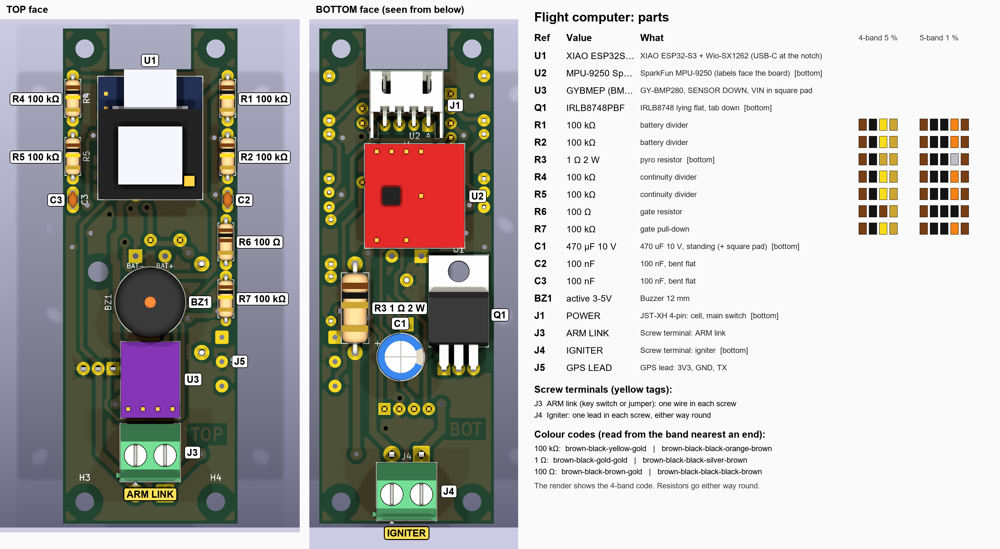

# Flight computer PCB (KiCad 10)

KiCad project of the flight computer. The schematic is the **wiring master**:
pin numbers follow [include/board_pins.h](../../include/board_pins.h), and
[docs/HARDWARE.md](../../docs/HARDWARE.md) explains each circuit.

| File | Contents |
|---|---|
| `rocket-fc-flight.kicad_pro` | Project, design rules and net classes |
| `rocket-fc-flight.kicad_sch` | Schematic (one A3 sheet) |
| `rocket-fc-flight.kicad_pcb` | Board: 30 x 78.2 mm (85.2 mm with the mounting ears), two layers |
| `lib/rocket-fc.kicad_sym` | Symbols: XIAO ESP32-S3 + Wio-SX1262, SparkFun MPU-9250 breakout, 4-pin GY-BMP280, L76K |
| `lib/rocket-fc.pretty/` | Footprints of those modules |
| `lib/rocket-fc.3dshapes/` | Simplified 3D models of those (boxes and cylinders, for the renders and the tube check by eye) |
| `out/` | Generated files (not committed) |

The library tables use `${KIPRJMOD}`, so the project opens on any computer
with no library setup.

**Status:** schematic done (ERC clean), board routed with a GND pour on
both faces: DRC 0 problems, schematic parity 0, `tools/pcb_check.py` ok.
Laser files ready (below); test etches of the raster method done, the
vector isolation method still to try.

Routing uses both faces and **27 wire vias**: a hole with a short wire
soldered on both sides wherever a track changes face (no plated holes).

## Layout

The board sits centred in the 32 mm airframe, so the tall parts are on the
centre line and only low parts (resistors lying flat) are near the edges.
`y` runs from the XIAO's USB face (0) to the far end (78.2 mm).

| Zone (y, mm) | Top | Bottom |
|---|---|---|
| −7–0 | Two ears with M3 holes H1, H2; the notch between them is free for the USB-C plug | Power plug J1 enters through the same notch |
| 0–34 | XIAO with the Wio-SX1262 on top, USB-C flush with the notch; continuity divider (R4, R5, C3) on the left edge, battery divider (R1, R2, C2) on the right; BAT+ / BAT− wire pads | J1: JST-XH 4-pin side entry (1–2 cell, 3–4 main switch); SparkFun MPU-9250 |
| 25–56 | Buzzer centred (34–46), gate resistors R6, R7 and the GPS lead pads J5 on the right edge | IRLB8748 (left) and 1 Ω 2 W resistor (right) lying flat (32–53); 470 µF standing between them (45–54) |
| 46–61 | 4-pin GY-BMP280, sensor side down, header at its far edge | |
| 61–78 | Screw terminal J3 (ARM link), centred | Screw terminal J4 (igniter), centred, staggered behind J3 |
| 71–78 | M3 holes H3, H4 in the corners | |

- **USB:** the XIAO's USB-C face is at the board edge, in a 14 mm wide notch
  between the two ears, so the plug goes straight in with the board on its
  sled.
- **Screw terminals:** one per face, both on the centre line (where the tube
  is tallest), wires entering from the far end. J4 is 6.6 mm further along
  than J3 so that neither covers the other's solder joints.
- **No status LED** (the buzzer stays): see docs/HARDWARE.md.
- The L76K GNSS module is off the board, near the nose, on a 3-wire lead
  soldered to J5 (3V3, GND, TX); its symbol and footprint stay in the library.

| Footprint | Source |
|---|---|
| XIAO + Wio-SX1262 (U1) | XIAO pattern: 2 x 7, 2.54 mm pitch, rows 15.24 mm apart, 21 x 17.8 mm; **5V, D8, D9, D10 have no pad** (pull those pins out of the header strip before soldering it: the radio uses them through its own connector); two wire pads for the BAT pads on the XIAO underside, past the MPU |
| SparkFun MPU-9250 (U2) | SparkFun's Eagle board file, v10 (17.0 x 17.8 mm); chip side away from the board (its labelled side faces the PCB); **AD0, INT, AUXCL, AUXDA have no pad** (pull those pins); its standoff holes are not drilled (they would hit the XIAO pins) |
| GY-BMP280 4-pin (U3) | 10 x 13 mm, 2.54 mm header along a 10 mm edge. **Mounted sensor side down** (labels up, VIN in the square pad): with the sensor up, the real board's pin order (VIN GND SCL SDA) runs the other way to this footprint. The BMP280 then hangs about 1.5 mm above C1's joints |
| C1 470 µF 10 V | KiCad CP_Radial_D8.0mm_P3.50mm, standing on the bottom (12.5 mm tall at most) |
| Everything else | KiCad standard library: resistors lying flat (7.62 mm), 1 Ω 2 W (DIN0414, 15.24 mm), TO-220 lying flat, JST-XH 4-pin side entry, 5.08 mm screw terminals, 12 mm buzzer, solder-wire pads for the GPS lead. The two 100 nF discs sit at the board edge: **bend them flat** (3.5 mm high at most) |

## Parts

Every part tagged on the 3D render, what goes into each screw terminal
(yellow tags), each part's value and what it is, and for the resistors the
colour code (4-band 5 %, 5-band 1 %; the render shows the 4-band one). Parts
on both faces: the bottom panel is seen from below. `python
tools/pcb_export.py board` redraws it (`tools/pcb_parts.py`, needs Pillow).

## Making the board (laser and etch)

Both faces carry a **GND pour**: the copper between the tracks is kept and
tied to GND (0.7 mm from every other net, thermal spokes on GND pads), so
the laser only has to clear a band around each track and pad, and the etch
removes far less copper. Pieces of the pour that reach no GND pad stay as
floating copper (harmless). No copper under Q1's metal tab or the M3 screw
heads (keep-out areas; `tools/pcb_check.py` checks it). The tracks still
make every connection; the pour only adds to the GND ones.

`python tools/pcb_export.py laser` writes to `out/laser/`:

| File | Use |
|---|---|
| `…-top-isolation.nc`, `…-bottom-isolation.nc` | **Vector isolation G-code** (method A, below): outlines around all copper, the bottom mirrored |
| `…-top.svg`, `…-top-0.08mm.png` | Top copper as a raster image (method B), **negative**: black = laser fires (paint off, copper etched), white = copper stays. Every hole centre is a small black dot, so the etch leaves a pit that centres the drill; the M3 holes are small copper dots |
| `…-bottom.svg`, `…-bottom-0.08mm.png` | Bottom copper, the same, **mirrored** (as seen from below) |
| `…-jig.svg` | Registration jig: two 3 mm pin holes at the H1 and H4 positions |
| `….drl`, `…-drl_map.pdf`, `…-drill-report.txt` | Drill file (mm), drill map and hole count per size |
| `…-placement-map.png` | Where every part goes, both faces as lasered, with the 27 wire vias (red X) and the pins to solder on both faces (red ring, on the part's face): print it for assembly. Needs PyMuPDF (`pip install pymupdf`), like the PNGs |

Every file uses the same frame, the board outline's bounding box (30.0 x
85.17 mm), so they line up when placed at the same position:

- **LaserGRBL:** give every job the **same Offset X / Y** (e.g. 0, 0) and
  never move the bed or the jig between them. The G-code coordinates already
  start at the lower-left corner of that box (X 0–30, Y 0–85.17), so run it
  with the same origin as the jig. The PNGs come out 30.0 x 85.2 mm from
  their DPI (Autosize on): within half a line of the SVGs.
- **LightBurn:** one project, one layer each, align their centres; set the
  jig's outline to a layer that does not output.

### Method A: vector isolation (recommended, about 15 minutes a face)

`tools/pcb_isolation.py` turns KiCad's copper into outlines for the laser:
rings around all copper, starting half a spot from its edge, 20 % overlap,
until a 0.4 mm band is clear (where two rings meet in a narrow gap the gap
is already clear, and an outline never enters copper). The keep-out areas
are cleared completely except for a small copper dot at each M3 hole centre
(the drill mark); every plated hole gets a burned dot at its centre (the
etched pit centres the drill); the board outline is traced as a cutting
line. It then checks its own result: the copper left must contain all of
the design's copper, and no two nets may end up joined (a run that fails
exits with an error).

Open the `.nc` file in LaserGRBL (*File → Open*) and run it. The power is
M4 (dynamic): with GRBL's laser mode on (`$32=1`) the power drops in the
corners where the head slows down, so they do not over-burn. Settings, as
environment variables for `python tools/pcb_export.py laser`:

| Variable | Default | Meaning |
|---|---|---|
| `LASER_SPOT` | 0.1 | Burned line width (mm): measure a line on the test scrap |
| `LASER_BAND` | 0.4 | Width cleared around the copper (mm) |
| `LASER_FEED` | 1000 | Speed (mm/min) |
| `LASER_S` | 980 | Power, of GRBL's `$30` maximum (1000 by default) |

### Method B: raster image (about 70 minutes a face)

The PNGs are for raster software such as LaserGRBL: pure black and white,
one pixel per line, 0.08 mm (12.5 lines/mm, stored in the file as 317.5
dpi). Lines narrower than the spot leave stripes of paint between them, so
the spacing is smaller than a diode laser's spot. Each face gets **two
passes without moving anything** in between:

1. **Horizontal:** load the PNG with **Passthrough** (engraves it exactly
   as it is, one line per pixel row; Autosize from the DPI).
2. **Vertical:** load the same PNG again with **Line To Line Tracing**,
   *Direction: Vertical*, *Quality* 12.5 lines/mm (the file's own
   resolution, so it is not resampled), same size and offset; check in the
   preview that it matches the image. It clears the paint left between the
   horizontal lines and cuts the vertical edges straight (one pass alone
   leaves a sawtooth on the edges across its lines).

Avoid **Vectorize**: it smooths the outlines and thins narrow tracks and pad
rings. For another line spacing set `LASER_LPMM` (lines per mm, e.g.
`LASER_LPMM=10 python tools/pcb_export.py laser` for 0.1 mm) and use the
same value as the vertical pass's Quality.

### Steps

1. **Blank:** double-sided FR4, 1.6 mm, at least 36 x 92 mm. Clean both
   faces (fine abrasive pad, then isopropyl alcohol) and spray thin coats of
   matte black paint on both. **Find the laser settings on a scrap** painted
   the same way first:
   - a power ladder at a fixed speed (e.g. 50, 65, 80, 98 % at 1000 mm/min);
     take the **lowest power that leaves bright copper**: more power burns
     past the edges and thins tracks and pad rings;
   - method A: measure the width of a single burned line and set
     `LASER_SPOT` to it (re-export), so the rings overlap properly;
   - method B: try both passes (horizontal, then vertical); if stripes of
     paint still stay between the lines, re-export with `LASER_LPMM=15`
     (0.067 mm);
   - LaserGRBL laser mode: M4 (dynamic) is better if GRBL's laser mode is on
     (`$32=1`); for the raster, M3 (constant power) also works, since every
     line ends in the margin outside the board.
2. **Top:** laser `top` onto the blank (method A: the `.nc` file; method B:
   both raster passes).
3. **Drill the four M3 holes** (3.2 mm) on their marks: they register the
   second face.
4. **Jig:** fix a sheet of cardboard or MDF to the bed and, without moving
   it afterwards, cut `jig` into it (a vector job: enough power and passes
   to cut through, at the same offset as the copper). Push two 3 mm pins
   into the holes (drill bits shank-down, or M3 screws from below),
   standing no higher than the board.
5. **Bottom:** flip the board **left to right** (about its long axis) onto
   the pins: H2 and H3 now sit on them. Laser `bottom` at the same position
   as the jig.
6. **Etch** both faces (ferric chloride or sodium persulfate), strip the
   paint with acetone. **TOP and BOT must read correctly** on their faces; if
   BOT is mirror-writing, the bottom was not mirrored. Check every track for
   breaks and shorts with a meter before drilling (also each track against
   the GND pour next to it).
7. **Drill** from the etched pits, then cut and file to the outline (the
   thin copper line on each face). Bits:

| Bit | Holes |
|---|---|
| 0.8 mm | 27 wire vias, resistors, 100 nF, C1, GPS lead pads (J5) |
| 1.0 mm | XIAO, MPU-9250 and barometer headers, BAT pads, buzzer, power plug J1 |
| 1.2 mm | IRLB8748 (Q1) leads, 1 Ω 2 W (R3) |
| 1.3 mm | Screw terminals J3, J4 |
| 3.2 mm | M3 holes H1–H4 (step 3) |
| 3.5 mm | Q1's tab hole (a 3.2 mm hole also takes the M3 screw) |

## Assembly order

No plated holes: a part is soldered on the face opposite to it, and some
joints end up under a part. `tools/pcb_check.py` lists them, and the
placement map (`out/laser/…-placement-map.png`) shows where each part goes,
the wire vias and the both-face pins; in practice:

0. **All 27 wire vias first**: a bare wire (e.g. a resistor lead offcut)
   through each 0.8 mm via hole, soldered on both faces and trimmed flush.
   Several sit under parts (the XIAO, MPU, power plug, buzzer, barometer,
   J3, R3, R7).
1. Small parts in the edge strips, then Q1, R3 and C1 (bottom). **Trim C1's
   joints flush** on the top and put Kapton tape over them: the barometer's
   sensor hangs over them.
2. J1, the power plug (bottom): its pins are soldered on top, under where
   the XIAO goes.
3. The XIAO's header strips (top, **low male headers, not sockets**: the
   stack must stay under 11.9 mm; 5V, D8, D9, D10 pulled), soldered on the
   bottom and **trimmed flush**: the MPU board sits over these joints.
   The strips go on without the XIAO (it is soldered onto them in step 5),
   so a XIAO that already has header pins must lose them first.
4. The MPU-9250 on its headers (bottom), soldered on the top between the
   XIAO header strips.
5. The XIAO with the Wio-SX1262 onto its header strips, soldered from above,
   and the two wires from the XIAO's BAT pads to BAT+ / BAT− (past the MPU,
   both faces free).
6. The buzzer (top), soldered on the bottom; then the barometer (top),
   **sensor side down**, labels up, VIN in the square pad.
7. Screw terminals, the GPS lead.

Pins that `tools/pcb_check.py` lists under "solder on both faces" carry
copper on both sides and need a joint on each.

## Ordering from a PCB maker

The same board can be ordered from a PCB maker instead of etched at home.
`python tools/pcb_export.py fab` writes `out/fab/`:

| File | Use |
|---|---|
| `rocket-fc-flight-fab.zip` | **Upload this.** Gerbers (Protel extensions: `.gtl`/`.gbl` copper, `.gts`/`.gbs` mask, `.gto`/`.gbo` silkscreen, `.gm1` outline), Excellon drill files in mm (`-PTH.drl` plated, `-NPTH.drl` unplated), Gerber job file |
| `gerbers/` | The same files unzipped, to open in KiCad's Gerber Viewer |
| `…-drill-report.txt` | Hole sizes and counts: plated 0.8–1.3 mm (86), unplated 3.2 mm (M3 holes) and 3.5 mm (Q1's tab) |

Only copper, mask, silkscreen and the outline go in; the laser jig
(`User.1`), the fab, courtyard and comment layers stay out. Check the
maker's preview after uploading: outline with the USB notch, the four M3
holes and Q1's tab hole unplated, TOP / BOT readable on their faces.

Order settings (enter them on the maker's page):

| Setting | Value |
|---|---|
| Layers | 2 |
| Size | 30 x 85.2 mm (read from the outline) |
| Material, thickness | FR4, 1.6 mm |
| Copper | 1 oz (35 µm) outside |
| Surface finish | lead-free HASL (ENIG works too, at more cost) |
| Solder mask, silkscreen | green, white (any colour works) |
| Vias | tented (as designed; an untented via just gets a tinned ring) |
| Quantity | 3 at Aisler (sold in sets of 3), 5 at JLCPCB / PCBWay (their minimum) |
| Everything else | default: one design, single board (no panel), no castellated holes, gold fingers or edge plating; at JLCPCB "Remove Mark" if wanted |

The GND pour stays on a made board too (it is normal there, and helps the
radio's ground). A made board has **plated holes**, which changes the
assembly:

- Every hole joins the two faces, so each pin is soldered once, on the face
  opposite its part, and the 27 wire vias are ordinary vias: **no wires**,
  skip step 0 of the assembly order.
- The order of the parts above still holds where they stack (C1 before the
  barometer, J1 and the XIAO header strips before the MPU, joints under a
  module trimmed flush, Kapton over C1's joints).
- `tools/pcb_check.py` and the "solder on both faces" list are for the
  home-made board only.

Checked against the makers' rules (DRC with the silkscreen and mask rules
switched on, on a copy of the project): no mask bridges; 24 silkscreen
warnings, all cosmetic (silkscreen over pads is cut away by the maker, three
reference labels and part of J4's outline touch the board edge). Silkscreen
text is 1.0 mm (BAT+ / BAT− 0.8 mm, below JLCPCB's 1.0 mm minimum: may print
blurred) and lines 0.12 mm (thickened or faint below the usual 0.15 mm).
The USB notch's inner corners come out rounded by the router bit (about
0.5–1 mm radius); the USB-C plug and J1's plug stay clear of them. The
0.8 mm vias are too large to tent reliably: the mask may sink into the hole,
which does no harm.

## Checks

`python tools/pcb_export.py` (from the repository root) runs:

- **ERC** on the schematic.
- **DRC** with schematic parity. Silkscreen and solder-mask rules are off
  (home-made board: neither). Holes inside another part's courtyard are
  allowed: that is how the board fits, and the next check covers it.
  Floating pieces of the GND pour ("isolated copper") are allowed, and a GND
  pad may join the pour with a single thermal spoke (each has its track).
- **`tools/pcb_check.py`** (with KiCad's Python), the rules of a board without
  plated holes:
  - every through-hole joint can be soldered (on the face opposite its part,
    or on its own face when the pin is exposed there, e.g. a lying resistor);
    joints under a module give the assembly order above;
  - every track meets a pin only on a face where that pin is soldered, and
    wire vias sit where both faces are reachable;
  - no foreign copper (tracks, vias or the GND pour) under the IRLB8748's
    metal tab (it is the drain) or under the M3 screw heads;
  - every part fits the tube: 15.5 mm radius, its height (table in the
    script) at its distance from the centre line.

Measure before etching (the heights in `tools/pcb_check.py` are estimates):

| Part | Assumed | Limit where it sits |
|---|---|---|
| XIAO + Wio-SX1262 stack on its headers | 10.0 mm | 11.9 mm |
| Screw terminals J3, J4 | 10.0 mm | 13.8 mm |
| Buzzer | 9.5 mm | 13.5 mm |
| C1 470 µF standing (bottom) | 12.5 mm | 13.9 mm |

## Board constraints

- Airframe inner diameter 32 mm: board centred, 30 mm wide; four M3 holes
  for the sled (two ears at the USB end, two corners at the far end).
- Off the board: 18350 cell and main switch (J1), arm link (J3), igniter
  (J4), GPS module (J5 lead).
- Made at home: laser-exposed resist and etching, two layers, no plated holes.
  Through-hole parts only (their leads also join the two sides).
  Design rules (project settings): tracks ≥ 0.4 mm, clearance 0.3 mm,
  copper ring ≥ 0.35 mm, vias as soldered wire (0.8 mm drill, 1.6 mm pad
  at least).
- **Fattened for the laser:** the first test etch lost thin tracks and pad
  rings (the laser burns past the edge of each black area, so copper shrinks
  and gaps widen). Every track, via and pad was then grown in place, routing
  unchanged, into half the free room to each neighbour, keeping 0.3 mm gaps:
  tracks +0.16–0.30 mm (0.4 → 0.56–0.70, 0.6 → 0.8–0.9, 1.0 → 1.2–1.3), via
  pads 1.8–2.1 mm, part pads +0.2–0.5 mm where the pitch allows. The pads are
  enlarged on the board itself, so they differ from the library footprints
  (that DRC check is off): **Update Footprints from Library** would shrink
  them back.
  A wire via may sit under a part (soldered and trimmed before the part is
  fitted), never under the MOSFET's metal tab.
- **GND pour** on both faces: zone clearance 0.7 mm (wider than the 0.3 mm
  between tracks: without solder mask, solder bridges easily across a narrow
  gap), minimum width 0.6 mm, thermal reliefs 0.6 mm gap and spokes, pieces
  under 1 mm² dropped. Keep-out areas under Q1's tab and around the M3 holes
  and Q1's tab hole (screw heads and nuts).
- Net classes (default widths for new tracks): **Pyro** (CELL+, ARM, IGN+,
  IGN-) 1.2 mm, **Power** (BAT_SW, +3V3, GND) 0.8 mm, **Default** 0.6 mm.
  A 1.0 mm track drops about 0.1 V over the board at the 2.7 A firing
  current (the pyro tracks are now 1.2–1.3 mm).

## Workflow

1. Open `rocket-fc-flight.kicad_pro` in KiCad 10 and edit. After a schematic
   change, update the board with **Tools → Update PCB from Schematic**.
   After moving anything on the board, **refill the zones** (*Edit → Fill
   All Zones*, key B) before saving: the exports use the saved fill.
2. Run `python tools/pcb_export.py` from the repository root: the checks
   above, `docs/schematics/flight.svg`, and in `out/` a printable schematic,
   1:1 placement prints (top, and bottom seen from below) and 3D renders.
   It exits with an error on any problem. `python tools/pcb_export.py laser`
   makes the laser files, `python tools/pcb_export.py fab` the order files
   for a PCB maker (above).
3. If the wiring changed, update `include/board_pins.h` and
   `docs/HARDWARE.md` in the same commit.

KiCad's backups, lock files, caches and per-user view settings (`*.kicad_prl`)
are git-ignored.
